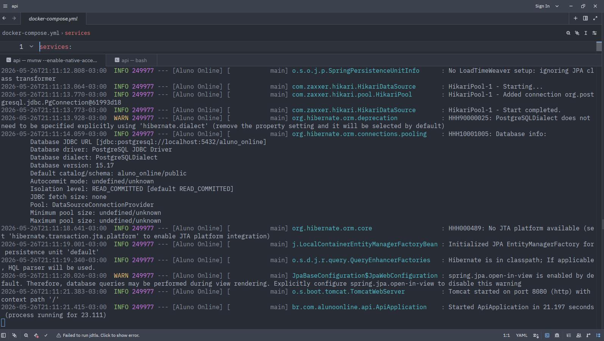
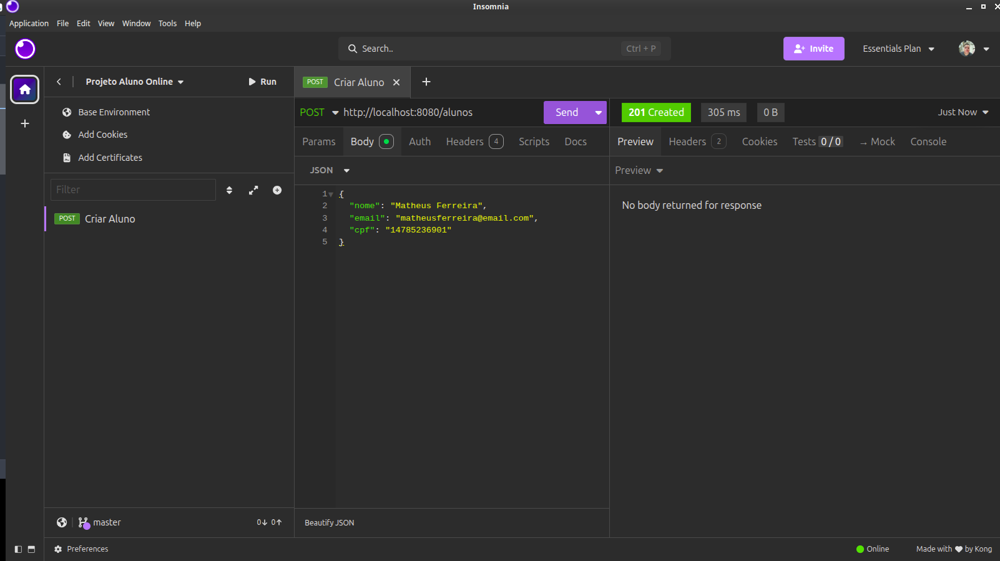
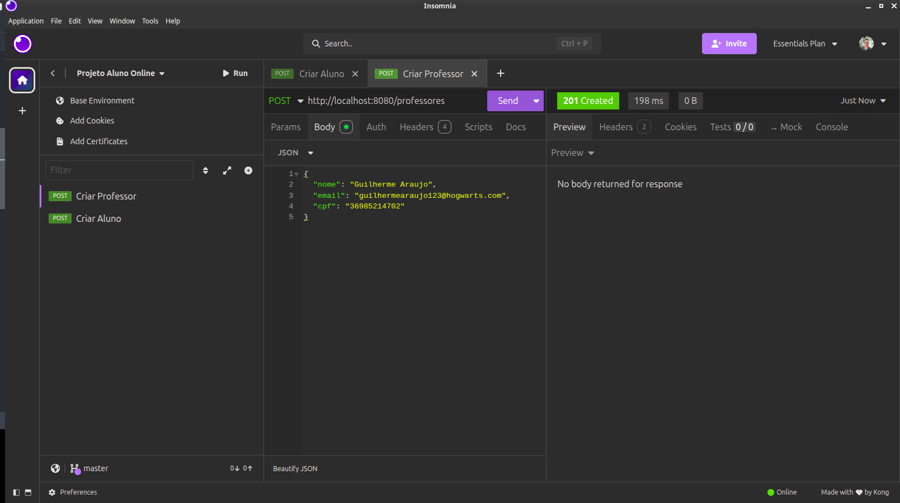
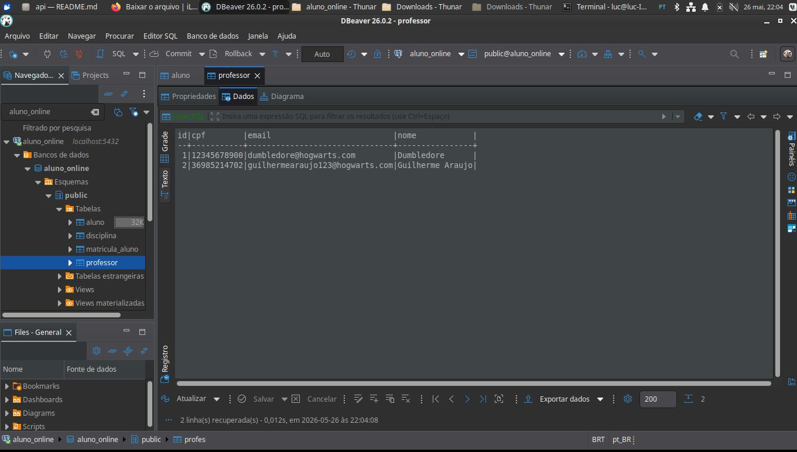
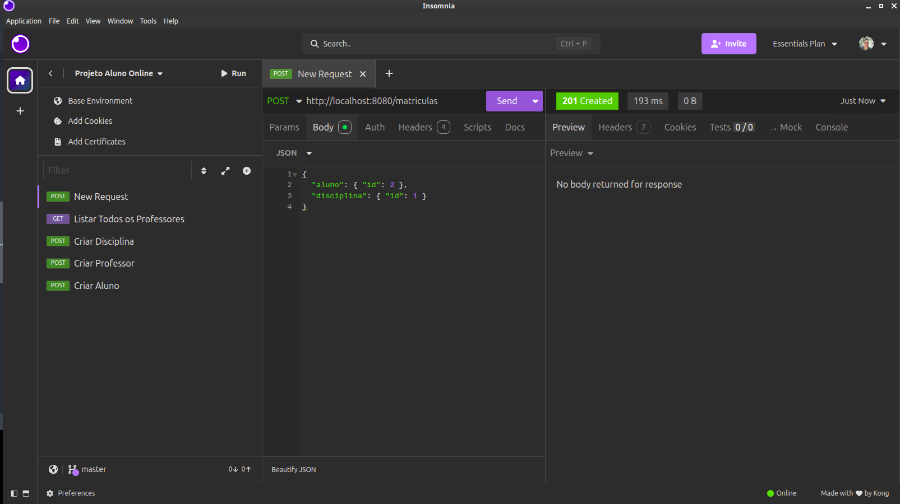
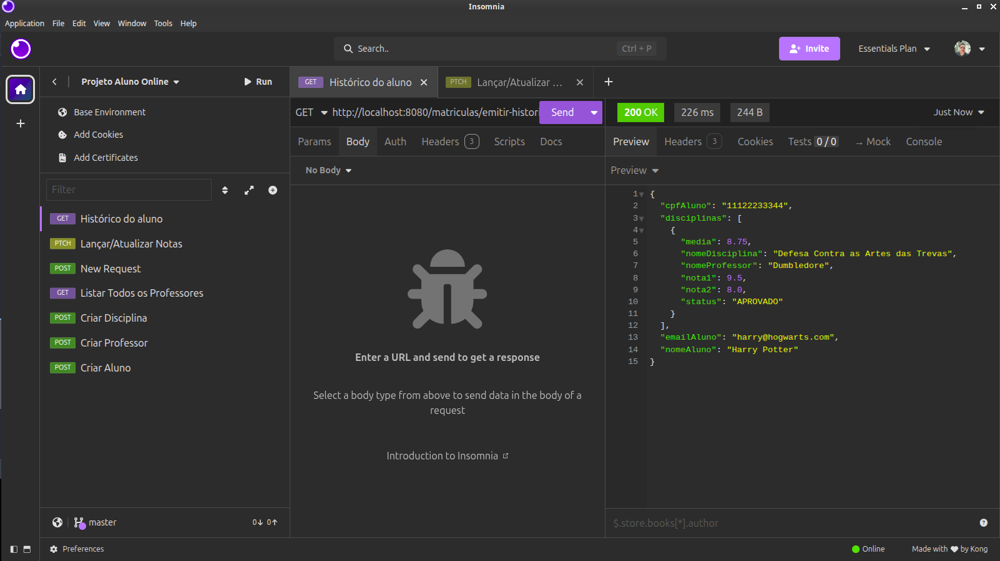
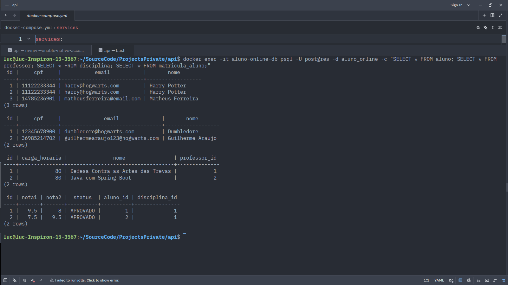

# Aluno Online API 

Este projeto é uma API REST desenvolvida em Java com Spring Boot para o gerenciamento de uma instituição de ensino. Ele permite o cadastro de alunos e professores, a criação de disciplinas, a realização de matrículas e o acompanhamento do desempenho acadêmico (notas, médias e histórico).

## Tecnologias Utilizadas

- **Java 21**
- **Spring Boot 4.0.6**
- **Spring Data JPA**: Para persistência de dados.
- **PostgreSQL**: Banco de dados relacional.
- **Docker & Docker Compose**: Para orquestração do banco de dados.
- **Lombok**: Para redução de código boilerplate (Getters, Setters, etc).
- **Maven**: Gerenciador de dependências.

---

## Arquitetura

O projeto segue a arquitetura de camadas padrão do ecossistema Spring:

1.  **Model**: Entidades que representam as tabelas no banco de dados (`Aluno`, `Professor`, `Disciplina`, `MatriculaAluno`).
2.  **Repository**: Interfaces que utilizam o Spring Data JPA para comunicação com o banco de dados.
3.  **Service**: Camada de lógica de negócio, onde as regras (como cálculo de média e status de aprovação) são processadas.
4.  **Controller**: Camada de exposição da API, definindo os endpoints REST e recebendo as requisições HTTP.
5.  **DTO (Data Transfer Object)**: Objetos utilizados para customizar o retorno de dados, como na emissão do histórico escolar.

---

## Detalhamento do Código

### Funcionalidades Principais:
- **Gestão de Alunos/Professores**: CRUD completo para manutenção dos cadastros.
- **Matrícula**: Associa um aluno a uma disciplina, iniciando com o status `MATRICULADO`.
- **Lançamento de Notas**: O sistema permite atualizar as notas do aluno. Quando ambas as notas são lançadas, o sistema calcula a média automaticamente:
  - `Média >= 7.0`: Status vira `APROVADO`.
  - `Média < 7.0`: Status vira `REPROVADO`.
- **Histórico Escolar**: Gera um relatório consolidado contendo os dados do aluno e todas as suas disciplinas com respectivas notas, médias e status.

---

## Testes e Validação (Insomnia)

*Nesta seção estão documentadas as requisições realizadas para validar o fluxo do sistema.*

### 1. Arquivo docker-compose.yml


### 2. Print Container Docker Rodando


### 3. Projeto Rodando


### 4. Criação de Aluno


### 5. Tabela Aluno no Dbeaver


### 6. Criando Professor


### 7. Tabela Professore no Dbeaver


### 8. Listando Todos os Professores


### 9. Criando Disciplina


### 10. Matriculando Aluno na Disciplina


### 11. Lançando/Atualizando Notas


### 12. Emissão de Histórico


### 13. Todas as Tabelas do banco


### 14. Comandos Curl usados para testar e validar

  '''
    1. Cadastro de Professores

curl -X POST http://localhost:8080/professores \
-H "Content-Type: application/json" \
-d '{
  "nome": "Alvo Dumbledore",
  "email": "dumbledore@hogwarts.com",
  "cpf": "12345678900"
}'

2. Cadastro de Alunos

curl -X POST http://localhost:8080/alunos \
-H "Content-Type: application/json" \
-d '{
  "nome": "Harry Potter",
  "email": "harry@hogwarts.com",
  "cpf": "11122233344"
}'

3. Cadastro de Disciplina (Vinculada ao Professor ID 1)

curl -X POST http://localhost:8080/disciplinas \
-H "Content-Type: application/json" \
-d '{
  "nome": "Defesa Contra as Artes das Trevas",
  "cargaHoraria": 80,
  "professor": {"id": 1}
}'

4. Realização da Matrícula (Aluno 1 na Disciplina 1)

curl -X POST http://localhost:8080/matriculas \
-H "Content-Type: application/json" \
-d '{
  "aluno": {"id": 1},
  "disciplina": {"id": 1}
}'

5. Lançamento de Notas (Na Matrícula ID 1)

curl -X PATCH http://localhost:8080/matriculas/atualizar-notas/1 \
-H "Content-Type: application/json" \
-d '{
  "nota1": 9.5,
  "nota2": 8.0
}'


6. Emissão do Histórico

curl -X GET http://localhost:8080/matriculas/emitir-historico/1
  '''
  
---

## Como rodar o projeto

1.  Certifique-se de ter o Docker instalado.
2.  Suba o banco de dados:
    ```bash
    docker compose up -d
    ```
3.  Execute a aplicação:
    ```bash
    ./mvnw spring-boot:run
    ```
4.  A API estará disponível em: `http://localhost:8080`

## Autor

Lucas Araújo
