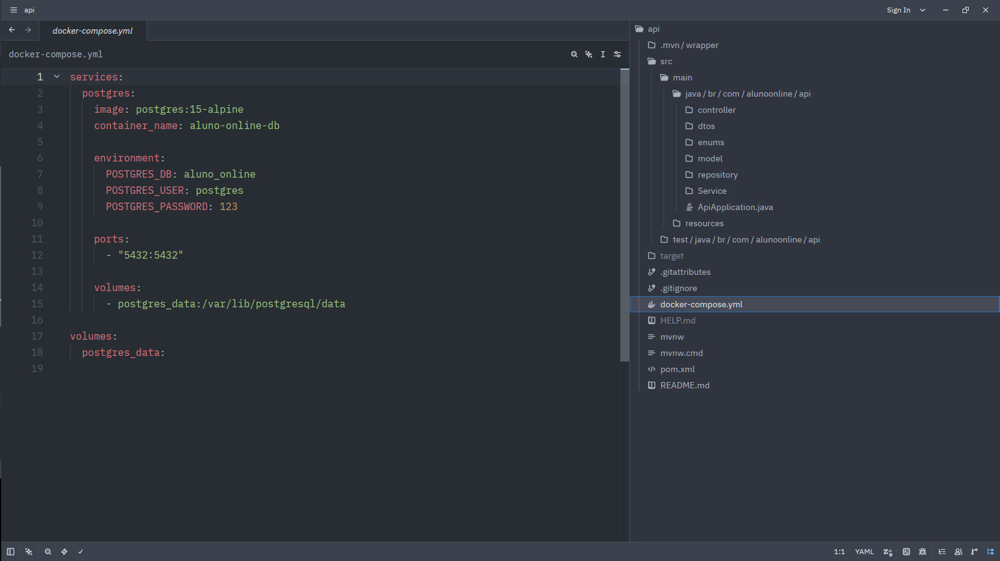
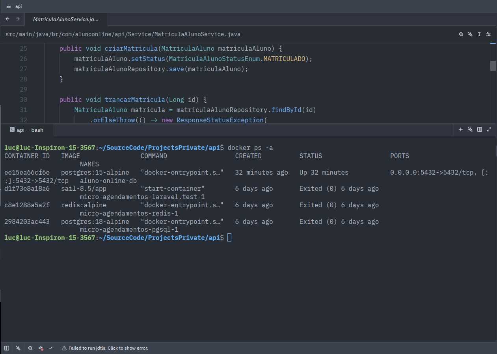
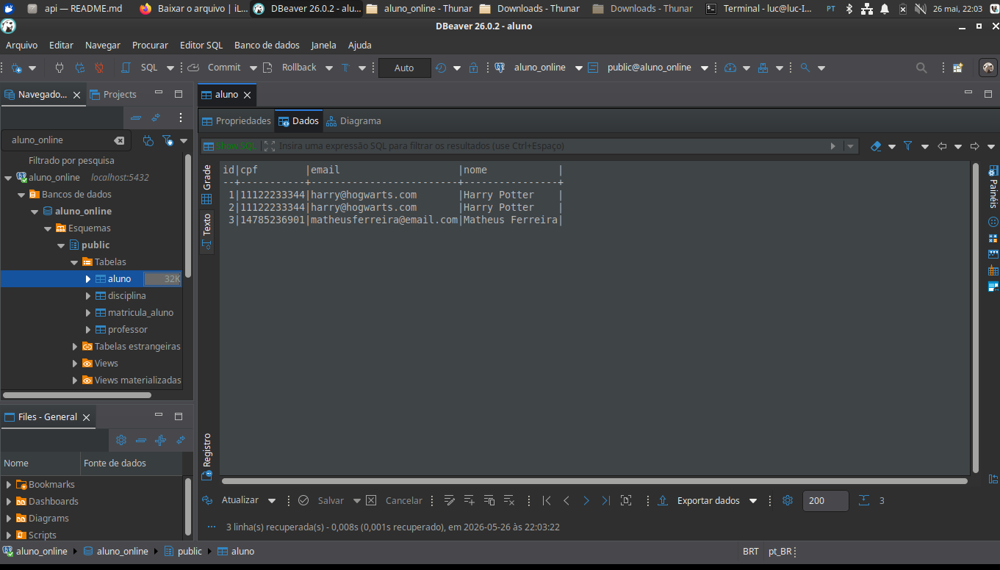
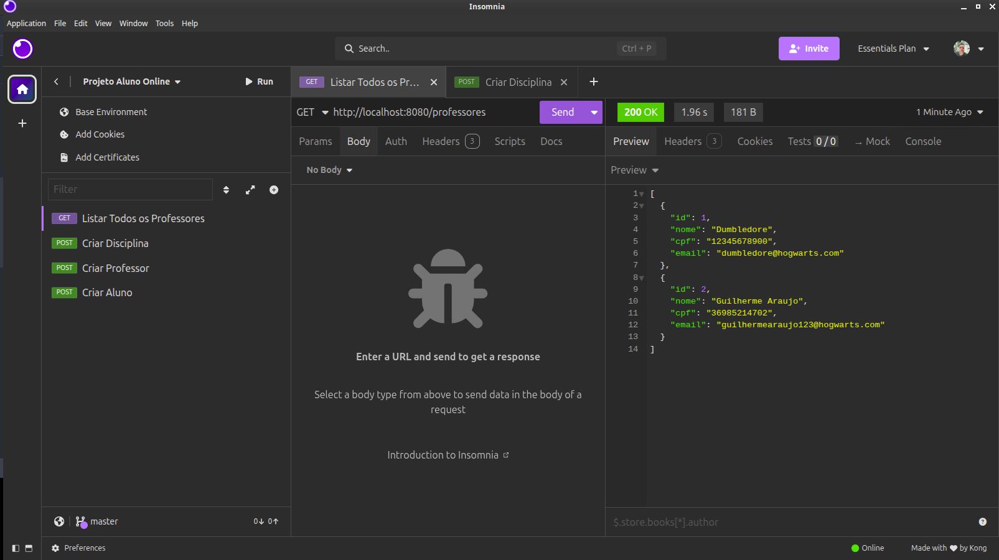
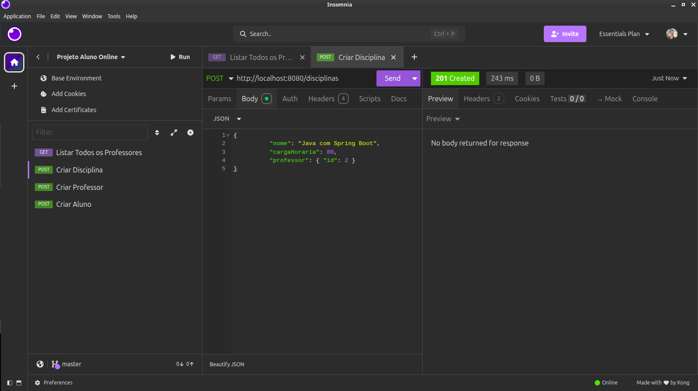
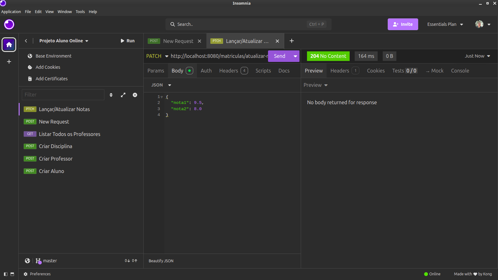

# Aluno Online API

API REST desenvolvida em Java com Spring Boot para o gerenciamento de uma instituição de ensino. Permite cadastrar alunos e professores, criar disciplinas, realizar matrículas, lançar notas e emitir históricos escolares.

## Tecnologias utilizadas

- **Java 21**
- **Spring Boot 4.0.6**
- **Spring Web MVC**: criação dos endpoints REST.
- **Spring Data JPA**: persistência de dados.
- **Spring Security**: autenticação e controle de acesso.
- **JWT (Auth0 java-jwt)**: geração e validação de tokens para autenticação stateless.
- **BCrypt**: codificação das senhas armazenadas.
- **Flyway**: versionamento do esquema do banco de dados.
- **PostgreSQL**: banco de dados relacional.
- **Docker e Docker Compose**: execução da infraestrutura.
- **Maven**: gerenciamento de dependências e build.
- **Lombok**: redução de código boilerplate.
- **Spring Boot Actuator**: verificação de saúde da aplicação.

---

## Arquitetura

O projeto segue a arquitetura em camadas do ecossistema Spring:

1. **Model**: entidades que representam as tabelas (Aluno, Professor, Disciplina, MatriculaAluno e Usuario).
2. **Repository**: interfaces Spring Data JPA para comunicação com o banco.
3. **Service**: regras de negócio da aplicação.
4. **Controller**: endpoints REST e tratamento das requisições HTTP.
5. **DTO**: objetos para receber dados e estruturar respostas.
6. **Config**: configurações, incluindo Spring Security e codificação de senhas.

---

## Funcionalidades

- **Gestão de alunos e professores**: cadastro, consulta, atualização e exclusão.
- **Disciplinas**: cadastro, consulta, atualização e exclusão.
- **Matrículas**: associação de alunos a disciplinas e trancamento.
- **Lançamento de notas**: cálculo automático da média quando ambas as notas são informadas:
  - Média maior ou igual a 7,0: APROVADO.
  - Média menor que 7,0: REPROVADO.
- **Histórico escolar**: consulta de disciplinas, notas, médias e situações do aluno.
- **Cadastro de usuários e autenticação**: credenciais vinculadas a um aluno ou professor e validação pelo Spring Security.

---

## Autenticação e segurança

O cadastro é realizado por POST /usuarios. Cada usuário deve ser vinculado a um aluno ou professor, e o login deve corresponder ao e-mail cadastrado para a pessoa vinculada.

As senhas são armazenadas utilizando BCrypt.

### Rotas públicas

| Método | Rota | Finalidade |
|---|---|---|
| POST | /usuarios | Cadastrar usuário |
| POST | /auth/login | Validar login e senha |
| GET | /actuator/health | Consultar a saúde da aplicação |

As demais rotas exigem autenticação.

### Cadastrar usuário

Exemplo de cadastro vinculado a um aluno existente:

~~~bash
curl -i -X POST http://localhost:8080/usuarios \
  -H "Content-Type: application/json" \
  -d '{
    "login": "aluno@instituicao.edu.br",
    "senha": "senha123",
    "alunoId": 1
  }'
~~~

Para vincular a um professor, utilize professorId no lugar de alunoId. Informe apenas um dos dois campos. A senha deve ter entre 8 e 72 caracteres.

### Realizar login e obter o JWT

O endpoint de login valida as credenciais e, quando são válidas, retorna um token JWT.

~~~bash
curl -i -X POST http://localhost:8080/auth/login \\
  -H "Content-Type: application/json" \\
  -d '{
    "login": "aluno@instituicao.edu.br",
    "senha": "senha123"
  }'
~~~

- Credenciais válidas: HTTP 200 OK, com o token no corpo JSON.
- Credenciais inválidas ou usuário inexistente: HTTP 401 Unauthorized.

Exemplo de resposta:

~~~json
{
  "token": "eyJhbGciOiJIUzI1NiJ9..."
}
~~~

### Acessar uma rota protegida

Envie o token recebido no login no cabeçalho Authorization, utilizando o esquema Bearer:

~~~bash
curl -i http://localhost:8080/alunos \\
  -H "Authorization: Bearer SEU_TOKEN_JWT"
~~~

O token é assinado com HMAC256 (HS256), identifica o usuário pelo login (subject), utiliza o emissor "API ALUNO ONLINE" e tem validade de duas horas. A API valida a assinatura, o emissor e a expiração antes de autenticar o usuário.

Sem token, com token inválido ou expirado, as rotas protegidas retornam HTTP 401 Unauthorized.

### Principais rotas da API

| Método | Rota | Finalidade | Acesso |
|---|---|---|---|
| POST | /alunos | Cadastrar aluno | Protegido |
| GET | /alunos | Listar alunos | Protegido |
| GET | /alunos/{id} | Consultar aluno | Protegido |
| PUT | /alunos/{id} | Atualizar aluno | Protegido |
| DELETE | /alunos/{id} | Excluir aluno | Protegido |
| POST | /professores | Cadastrar professor | Protegido |
| GET | /professores | Listar professores | Protegido |
| GET | /professores/{id} | Consultar professor | Protegido |
| PUT | /professores/{id} | Atualizar professor | Protegido |
| DELETE | /professores/{id} | Excluir professor | Protegido |
| POST | /disciplinas | Cadastrar disciplina | Protegido |
| GET | /disciplinas | Listar disciplinas | Protegido |
| GET | /disciplinas/{id} | Consultar disciplina | Protegido |
| PUT | /disciplinas/{id} | Atualizar disciplina | Protegido |
| DELETE | /disciplinas/{id} | Excluir disciplina | Protegido |
| POST | /matriculas | Realizar matrícula | Protegido |
| PATCH | /matriculas/trancar/{id} | Trancar matrícula | Protegido |
| PATCH | /matriculas/atualizar-notas/{id} | Atualizar notas | Protegido |
| GET | /matriculas/emitir-historico/{alunoId} | Emitir histórico | Protegido |

---

## Como executar o projeto

### Pré-requisitos

- Java 21.
- Maven (opcional, pois o projeto inclui Maven Wrapper).
- PostgreSQL ou Docker com Docker Compose.

### Opção 1 — Docker Compose

Crie um arquivo .env na raiz do projeto:

~~~env
DB_NAME=aluno_online
DB_USER=postgres
DB_PASSWORD=defina_uma_senha
~~~

Suba os containers:

~~~bash
docker compose up -d
~~~

### Opção 2 — Execução local da aplicação

Configure as variáveis de ambiente de conexão com o PostgreSQL e a chave secreta utilizada para assinar os JWTs:

- SPRING_DATASOURCE_URL
- SPRING_DATASOURCE_USERNAME
- SPRING_DATASOURCE_PASSWORD
- JWT_SECRET

A variável JWT_SECRET deve conter uma chave secreta com pelo menos 32 bytes. Mantenha esse valor privado e não o versione no repositório. Em ambientes como GitHub Codespaces ou Render, configure-o como secret/variável de ambiente.

Execute:

~~~bash
./mvnw spring-boot:run
~~~

A API ficará disponível em http://localhost:8080, salvo configuração diferente da porta.

### Verificar a saúde da aplicação

~~~bash
curl -i http://localhost:8080/actuator/health
~~~

Uma aplicação saudável retorna HTTP 200 OK e status UP.

---

## Testes automatizados

Execute os testes:

~~~bash
./mvnw clean test
~~~

Para gerar o pacote sem executar os testes:

~~~bash
./mvnw clean package -DskipTests
~~~

---

## Documentação complementar

- [Documentação de infraestrutura Docker](README_INFRA.md)

## Evidências do projeto

### 1. Arquivo docker-compose.yml

### 2. Container Docker em execução

### 3. Projeto em execução

### 4. Criação de aluno

### 5. Tabela de alunos no DBeaver

### 6. Criação de professor

### 7. Tabela de professores no DBeaver

### 8. Listagem de professores

### 9. Criação de disciplina

### 10. Matrícula de aluno em disciplina

### 11. Lançamento e atualização de notas

### 12. Emissão de histórico

### 13. Tabelas do banco de dados

---

## Autor

Lucas Araújo
